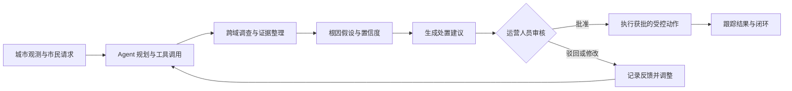
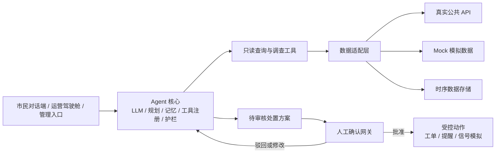

# 🏙️ CitySense Agent

**城市运营与市民服务智能体平台**

🛰️ 城市数据 · 🤖 Agent 分析 · 🧑‍💼 人工审核 · 🛠️ 受控处置

CitySense Agent 面向市民与城市运营人员，汇聚交通、环境和公共资源信息，由大语言模型驱动的智能体主动监测城市状态、跨域调查异常、生成处置建议，并在需要时交由运营人员确认。

> 🚧 本项目目前处于课程项目的需求分析与设计阶段。本文描述的是依据《软件需求规格说明书（SRS）》定义的目标系统，不代表相关功能已经实现。

## 🎯 项目目标

城市数据分散在交通、环境和市政等不同系统中。市民需要在多个入口间切换查询或报修，运营人员则需要自行关联告警和多源数据，才能判断原因和处置方式。

CitySense Agent 希望将被动查看数据的方式转变为主动运营流程：让市民通过自然语言查询城市信息、上报问题并接收提醒；让运营人员查看 Agent 的调查证据和处置建议，并保留对关键行动的审核权。

## 👥 用户与核心场景

| 用户 | 主要任务 |
| --- | --- |
| 市民 | 查询路况、空气质量和公共资源；报修或上报问题；请求出行建议；接收相关提醒 |
| 城市运营人员 | 查看城市态势与事件队列；审查处置建议；处理升级事件 |
| 系统管理员 | 配置数据源适配器、工具权限和 Agent 策略 |

## 🔄 核心工作流

Agent 可以自主完成只读监测和调查，并给出带有证据与置信度的根因假设。处置建议进入运营人员的审核队列；批准、驳回或修改都会形成反馈。未获确认的受控动作不得执行。

## 🧩 功能范围

需求规格说明书定义了以下 12 个用例：

| 参与者 | 用例 |
| --- | --- |
| 市民 | UC-01 查询城市状态；UC-02 报修或上报问题；UC-03 接收主动提醒；UC-04 请求出行方案 |
| 运营人员 | UC-05 审核处置建议；UC-06 监控运营驾驶舱；UC-07 处理升级事件 |
| 管理员 | UC-08 管理适配器与工具 |
| Agent | UC-09 持续监测与异常检测；UC-10 跨域调查与根因推理；UC-11 生成处置方案并请求确认；UC-12 执行已确认动作 |

核心事件响应链路为：**监测 → 调查 → 生成建议 → 人工确认 → 受控执行 → 跟踪闭环**。调查证据不足时，Agent 应标注不确定并升级处理，不得编造结论。

## 🛡️ 自主权限与安全边界

| 处理类型 | 权限边界 |
| --- | --- |
| 监测与调查 | Agent 可自主读取授权的城市数据、调用只读工具、关联证据并形成根因假设 |
| 建议与模拟 | Agent 可生成处置方案并进行模拟；方案需展示证据、置信度和预估影响 |
| 对外或现实影响 | 建工单、向市民发送提醒、落地信号方案等动作须经过人工确认；不得越权访问数据或未经确认执行物理操作 |
| 低置信度或高影响事件 | 必须进入运营人员审核或接管流程 |

系统还应对 Agent 动作保留审计记录，并对发送至第三方大语言模型的数据做脱敏处理。市民对话和位置数据遵循最小化使用与留存原则。

## 🏗️ 目标架构与数据策略

系统目标架构由用户入口、Agent 核心、工具层和数据适配层组成。Agent 核心包含 LLM、规划器、记忆、工具注册和安全护栏；数据适配器隔离真实数据接口与模拟数据源，便于后续替换和扩展。

目标数据域包括交通、环境和公共资源。需求规格中列出的接入方向包括高德、和风天气、PM25.in 等公共数据接口，以及用于补充停车、环卫等场景的 MockAdapter。InfluxDB、TimescaleDB 和 MQTT 是规格书中的技术示例；具体选型与接入实现仍需在后续设计中确认。

## 📊 非功能目标

以下是需求规格说明书中的目标值，当前仓库尚无实现或测试结果可用于验证。

| 质量属性 | 目标要求 |
| --- | --- |
| 性能 | 常规查询 < 2 秒；Agent 首轮响应（含首次工具调用）< 3 秒，端到端延迟目标按 P95 衡量 |
| 监测 | 监测周期可配置，默认 1–5 分钟 |
| 准确性 | 告警准确率目标 > 90%；根因假设标注置信度，证据不足时明确标注不确定 |
| 可靠性 | 数据源故障时降级并提示部分数据；工具调用失败可重试并转人工 |
| 安全性 | HTTPS、身份鉴权、运营与管理员角色分权（RBAC）、Agent 动作审计 |
| 可用性 | 市民端支持对话式交互；运营端关键操作不超过 2 次点击可达 |
| 成本 | 记录每个用例的 LLM token 成本；超出预算阈值时降级为规则模式 |

## 🚀 MVP 与路线图

MVP 聚焦一条真实环境数据链和一条模拟资源数据链，验证 Agent 从异常发现到建议审核的核心闭环。

| 阶段 | 计划交付 |
| --- | --- |
| S1 数据底座 | 数据适配器、真实 AQI 数据接入和 Mock 数据源 |
| S2 Agent 内核（MVP） | 监测、跨域调查、建议生成和转人工审核闭环 |
| S3 双端界面 | 市民对话端与运营驾驶舱 |
| S4 受控执行 | 工单创建、市民提醒和信号方案模拟等获批动作 |
| 验收 | 端到端演示与项目反思报告 |

## 📦 仓库现状

当前仓库仅包含本 README。应用源码、依赖清单、部署配置以及 SRS 中规划的 `models/*.puml` 建模文件尚未提交，因此目前没有可运行的安装或启动步骤。后续实现应以正式 SRS 和经确认的技术设计为准。

## 📚 需求来源

本文依据《软件需求规格说明书（SRS）：CitySense Agent — 城市运营与市民服务智能体平台》整理。SRS 定义了产品范围、12 个用例、Agent 权限边界、非功能目标和迭代路线图。
