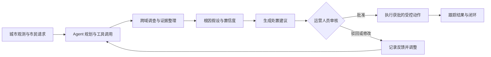
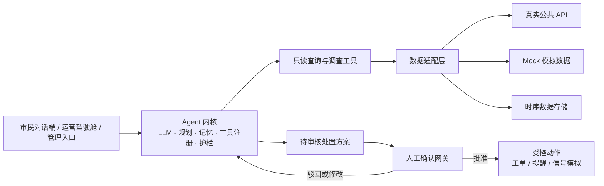

<div align="center">


<h1>CitySense Agent · 城市运营与市民服务智能体平台</h1>

<p>
<b>🛰️ 城市数据 · 🤖 Agent 分析 · 🧑‍💼 人工审核 · 🛠️ 受控处置</b><br/>
把「被动盯着大屏看」的城市管理，改成「Agent 主动发现、调查、提建议，人来拍板」
</p>

<p>
  
  
  
  
</p>

<p>
  <a href="#-项目目标">项目目标</a> ·
  <a href="#-用户与场景">用户与场景</a> ·
  <a href="#-工作流">工作流</a> ·
  <a href="#-权限边界">权限边界</a> ·
  <a href="#-目标架构">架构</a> ·
  <a href="#-路线图">路线图</a>
</p>

</div>

> [!WARNING]
> **本项目处于课程项目的需求分析与设计阶段。**
> 本文描述的是依据《软件需求规格说明书（SRS）》定义的**目标系统**，不代表相关功能已经实现。
> 仓库当前**只有这份 README**，没有源码、依赖清单或部署配置，因此**没有可运行的安装步骤**。

---

## 🎯 项目目标

城市数据散落在交通、环境、市政等不同系统里。市民要在多个入口之间来回切换才能查一条路况、报一次修；运营人员得自己把告警和多源数据拼起来，才能判断原因和处置方式。

CitySense Agent 想把这件事翻过来：市民用自然语言查城市信息、上报问题、收提醒；运营人员看 Agent 给出的调查证据和处置建议，并且**保留对关键动作的否决权**。

---

## 👥 用户与场景

| 用户 | 主要任务 |
|:--|:--|
| 市民 | 查询路况、空气质量、公共资源；报修上报；请求出行建议；接收相关提醒 |
| 城市运营人员 | 查看城市态势与事件队列；审查处置建议；处理升级事件 |
| 系统管理员 | 配置数据源适配器、工具权限与 Agent 策略 |

---

## 🔄 核心工作流

Agent 可以自主完成**只读**的监测与调查，并给出带证据和置信度的根因假设。处置建议进入运营人员的审核队列；批准、驳回、修改都会形成反馈。**未获确认的受控动作不得执行。**



---

## 🧩 功能范围

SRS 定义了 12 个用例：

| 参与者 | 用例 |
|:--|:--|
| 市民 | UC-01 查询城市状态 · UC-02 报修或上报问题 · UC-03 接收主动提醒 · UC-04 请求出行方案 |
| 运营人员 | UC-05 审核处置建议 · UC-06 监控运营驾驶舱 · UC-07 处理升级事件 |
| 管理员 | UC-08 管理适配器与工具 |
| Agent | UC-09 持续监测与异常检测 · UC-10 跨域调查与根因推理 · UC-11 生成处置方案并请求确认 · UC-12 执行已确认动作 |

核心链路：**监测 → 调查 → 生成建议 → 人工确认 → 受控执行 → 跟踪闭环**。
证据不足时，Agent 应标注不确定并升级处理，**不得编造结论**。

---

## 🛡️ 权限边界

这是整个设计里最要紧的一张表——Agent 的能力被刻意切得比它的知识更窄。

| 处理类型 | 边界 |
|:--|:--|
| 监测与调查 | 可自主读取授权数据、调用只读工具、关联证据、形成根因假设 |
| 建议与模拟 | 可生成处置方案并模拟；方案须展示证据、置信度与预估影响 |
| 对外或现实影响 | 建工单、向市民发提醒、落地信号方案等，**须经人工确认**；不得越权访问数据或未经确认执行物理操作 |
| 低置信度 / 高影响 | 必须进入运营人员审核或接管流程 |

系统还应保留 Agent 动作的审计记录，并对发往第三方大模型的数据做脱敏。市民对话与位置数据遵循最小化使用与留存原则。

---

## 🏗️ 目标架构

系统由用户入口、Agent 内核、工具层和数据适配层组成。Agent 内核包含 LLM、规划器、记忆、工具注册与安全护栏；数据适配器隔离真实接口与模拟数据源，方便后续替换。



数据域覆盖交通、环境、公共资源。SRS 中列出的接入方向包括高德、和风天气、PM25.in 等公共接口，以及补充停车、环卫场景的 MockAdapter。InfluxDB、TimescaleDB、MQTT 是规格书中的技术**示例**，具体选型仍待后续设计确认。

---

## 📊 非功能目标

以下均为 SRS 中的**目标值**，当前仓库没有实现或测试结果可供验证。

| 质量属性 | 目标 |
|:--|:--|
| 性能 | 常规查询 < 2 秒；Agent 首轮响应（含首次工具调用）< 3 秒；端到端按 P95 衡量 |
| 监测 | 周期可配置，默认 1–5 分钟 |
| 准确性 | 告警准确率目标 > 90%；根因假设标注置信度，证据不足时明确标注不确定 |
| 可靠性 | 数据源故障时降级并提示「部分数据」；工具调用失败可重试并转人工 |
| 安全性 | HTTPS、身份鉴权、RBAC 分权、Agent 动作审计 |
| 可用性 | 市民端对话式交互；运营端关键操作不超过 2 次点击可达 |
| 成本 | 记录每个用例的 token 成本；超预算阈值时降级为规则模式 |

---

## 🗺️ 路线图

MVP 聚焦「一条真实环境数据链 + 一条模拟资源数据链」，验证从异常发现到建议审核的核心闭环。

| 阶段 | 计划交付 |
|:--|:--|
| **S1 数据底座** | 数据适配器、真实 AQI 数据接入、Mock 数据源 |
| **S2 Agent 内核（MVP）** | 监测、跨域调查、建议生成、转人工审核闭环 |
| **S3 双端界面** | 市民对话端与运营驾驶舱 |
| **S4 受控执行** | 工单创建、市民提醒、信号方案模拟等获批动作 |
| **验收** | 端到端演示与项目反思报告 |

---

## 📦 仓库现状

```
CitySense_Agent/
└── README.md      ← 就这一个文件
```

应用源码、依赖清单、部署配置，以及 SRS 中规划的 `models/*.puml` 建模文件都尚未提交。后续实现应以正式 SRS 和经确认的技术设计为准。

---

## 📚 需求来源

本文依据《软件需求规格说明书（SRS）：CitySense Agent — 城市运营与市民服务智能体平台》整理。SRS 定义了产品范围、12 个用例、Agent 权限边界、非功能目标与迭代路线图。

---

<div align="center">

**同济大学 · 软件工程 · 系统分析与设计课程项目**

设计与文档可以先行，代码要等设计定稿。

</div>
